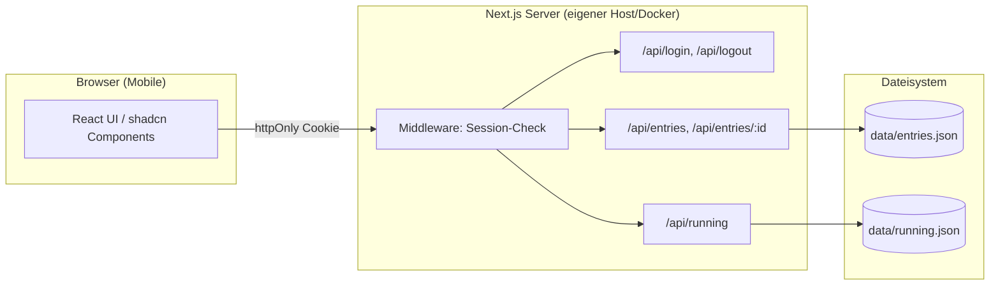
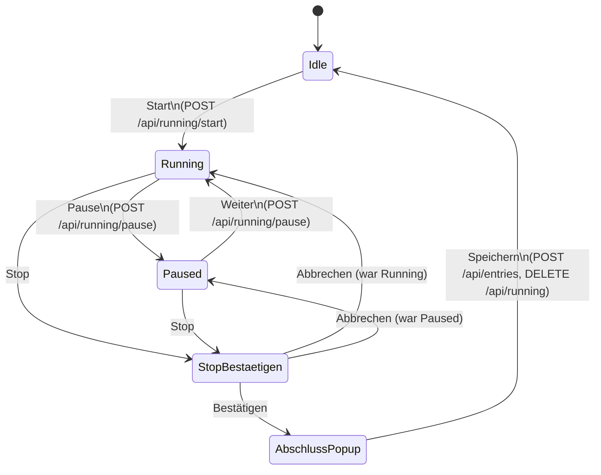

# Konzept: simpleTimeCatch – einfache Zeiterfassung

Kleine, mobil-optimierte Zeiterfassungs-Webseite für den persönlichen Gebrauch. Kein Datenbanksystem, Login-geschützt, Daten liegen als JSON-Datei auf dem Server.

---

## 1. Ziel & Rahmenbedingungen

- Einzelperson bzw. wenige Personen, seltene Nutzung → **keine Datenbank**, sondern eine **JSON-Datei** auf dem Server.
- **Mobile-first**: Hauptzielgerät ist das Smartphone, Desktop ist "nice to have", nicht der Fokus.
- **Login-Pflicht**: Inhalt ist ohne Login nicht sichtbar. Session **nicht** im `localStorage`, sondern als `httpOnly`-Cookie.
- **shadcn/ui**: Komponenten werden **nicht** über die CLI installiert, sondern manuell von `ui.shadcn.com/docs/components/base/<component>` → Tab **"Radix UI"** → Tab **"Installation" → "Manual"** kopiert. So ist sichergestellt, dass immer der shadcn-Standardstil (kein CLI-Theming-Zufall) verwendet wird und alle Komponenten konsistent auf **Radix UI** basieren.
- Gehostet auf einem eigenen Server/NAS/Docker-Container mit dauerhaftem Dateisystemzugriff (kein Serverless/Vercel) → JSON-Datei kann einfach gelesen/geschrieben werden.
- Login über **ein gemeinsames Passwort** (Server-Umgebungsvariable), kein Benutzerverwaltungssystem.
- **Pause** pausiert nur die Anzeige/den Zähler – erzeugt keinen eigenen Listeneintrag.
- **Zeitzone**: fest `Europe/Berlin` (keine Mehrzonen-Unterstützung, keine Auswahl).
- **Gruppierung**: ausschließlich bei identischer Tätigkeit **am gleichen Tag** – nie tagesübergreifend.
- **Datum im oberen Panel** ist reine Anzeige, kein Datepicker.
- **Tätigkeit-Eingabe** überall als Dropdown/Combobox der bisher verwendeten Tätigkeiten, zusätzlich frei eintippbar (Custom-Eingabe).
- **Listenzeilen** sollen vertikal so schlank wie möglich sein (wichtig für viele Einträge auf kleinem Screen).

---

## 2. Tech-Stack

| Bereich       | Wahl                                                                 |
|---------------|-----------------------------------------------------------------------|
| Framework     | **Next.js** (App Router) – liefert Frontend **und** API-Routes in einem Projekt, kein separates Backend nötig |
| UI            | React + **shadcn/ui** (manuell installiert, Radix UI-Basis) + Tailwind CSS |
| Daten         | JSON-Dateien im Dateisystem des Servers (`data/entries.json`, `data/running.json`) |
| Auth          | Passwort-Login → signiertes Session-Cookie (`httpOnly`, `secure`, `sameSite=strict`), Prüfung via Next.js Middleware |
| Icons         | `lucide-react` (Standard-Icon-Set von shadcn) |
| Zeit/Zeitzone | `date-fns` + `date-fns-tz`, alle Anzeigen/Berechnungen fest auf `Europe/Berlin` (DST wird von der Library automatisch berücksichtigt) |

Next.js wird gewählt, weil es API-Routes und Filesystem-Zugriff auf demselben Server erlaubt, ohne dass ein separates Backend aufgesetzt werden muss – passt zum "kein DB, aber ein bisschen Server-Logik"-Anspruch.

---

## 3. Architekturübersicht



Es gibt bewusst **keine** Business-Logik im Client, die Daten manipulieren könnte, ohne dass der Server sie validiert (z. B. Enddatum vor Startdatum verhindern) – das übernimmt die API-Schicht.

---

## 4. Auth-Konzept

1. `/login` zeigt ein einfaches Formular (Passwort-Input + Button), gebaut mit shadcn `Card`, `Input`, `Label`, `Button`.
2. `POST /api/login` prüft das übermittelte Passwort gegen `process.env.APP_PASSWORD`.
3. Bei Erfolg: Server erzeugt ein signiertes Token (z. B. HMAC mit `SESSION_SECRET`) und setzt es als **`httpOnly`, `secure`, `sameSite=strict`**-Cookie mit Ablaufzeit (z. B. 30 Tage). **Kein** `localStorage`/`sessionStorage`.
4. `proxy.ts` (Next.js 16-Nachfolger von `middleware.ts`) prüft bei **jedem** Request außer `/login` und `/api/login`, ob ein gültiges Cookie vorliegt → sonst Redirect nach `/login`.
5. `POST /api/logout` löscht das Cookie.

Benötigte Umgebungsvariablen:
```
APP_PASSWORD=...
SESSION_SECRET=...
```

---

## 5. Datenmodell

```ts
// data/entries.json
interface TimeEntry {
  id: string;          // uuid
  activity: string;    // Tätigkeit – auch der Gruppierungs-Key
  date: string;         // Datum des Starts, "YYYY-MM-DD"
  startTime: string;    // ISO-Datetime
  endTime: string;       // ISO-Datetime
  pausedMs: number;     // während der Aufzeichnung pausierte Zeit (ms)
  durationMs: number;    // (endTime - startTime) - pausedMs
}

// data/running.json (nur vorhanden, während ein Timer läuft)
interface RunningTimer {
  startTime: string;      // ISO-Datetime
  isPaused: boolean;
  pauseStartedAt: string | null; // ISO-Datetime, falls gerade pausiert
  accumulatedPauseMs: number;    // Summe bereits beendeter Pausen
}
```

`running.json` existiert **nur**, während ein Timer aktiv ist. So geht der laufende Timer nicht verloren, wenn das Handy-Display aus- oder das Tab neu geladen wird – der Client lädt beim Start den aktuellen Zustand per `GET /api/running` und rechnet die Anzeige lokal weiter hoch.

**Zeitzone**: Alle `*Time`-Felder werden als ISO-Datetime mit Offset gespeichert (z. B. `2026-08-13T22:15:00+02:00`), Anzeige und Eingabe (`datetime-local`) werden immer explizit als `Europe/Berlin` interpretiert/formatiert (`lib/time.ts`, via `date-fns-tz`) – unabhängig davon, in welcher Zeitzone der Server selbst läuft.

---

## 6. API-Endpunkte

| Methode | Pfad                 | Zweck                                              |
|---------|----------------------|-----------------------------------------------------|
| POST    | `/api/login`          | Passwort prüfen, Cookie setzen                      |
| POST    | `/api/logout`         | Cookie löschen                                      |
| GET     | `/api/running`        | Aktuellen Timer-Status abrufen (oder `null`)        |
| POST    | `/api/running/start`  | Timer starten, `running.json` anlegen               |
| POST    | `/api/running/pause`  | Pause umschalten (toggle)                           |
| DELETE  | `/api/running`        | Timer verwerfen (z. B. nach erfolgreichem Speichern) |
| GET     | `/api/entries`        | Alle Einträge lesen                                 |
| POST    | `/api/entries`        | Neuen Eintrag anlegen (nach Stop-Bestätigung)        |
| PATCH   | `/api/entries/:id`    | Eintrag bearbeiten                                  |
| DELETE  | `/api/entries/:id`    | Eintrag löschen                                     |

Alle Routen außer `/api/login` sind durch die Middleware geschützt.

Kein eigener Endpunkt für die Tätigkeits-Liste: Die Liste der bisher verwendeten Tätigkeiten (für das Dropdown) wird client-seitig aus den bereits geladenen `entries` (von `GET /api/entries`) dedupliziert.

---

## 7. UI-Layout (Mobile-First)

Die Seite ist in zwei Bereiche geteilt: **oberes Panel** (fixiert/oben, Stoppuhr) und **unterer Bereich** (scrollbare Liste).

```
┌─────────────────────────────────┐
│  Zeiterfassung            [Logout]│
├─────────────────────────────────┤
│   Mittwoch, 13. August 2026       │   <- Datum (nur Anzeige)
│                                    │
│           01:24:37                │   <- große Stoppuhr
│                                    │
│   [ Start ]  [ Pause ]  [ Stop ]  │   <- je nach Zustand ein-/ausgeblendet
├─────────────────────────────────┤
│ Mi, 13.08.2026                    │   <- Tages-Header (schlank, sticky)
│ ▾ Projekt A            2h15m      │   <- Gruppen-Node, 1 Zeile
│   08:00–09:30    1h30m   ✏️  🗑️  │   <- Kind-Zeile, 1 Zeile, eingerückt
│   10:00–10:15      15m   ✏️  🗑️  │
│   13:00–13:30      30m   ✏️  🗑️  │
│ Mails checken 09:35–09:55  20m ✏️🗑️│   <- einzelner Eintrag, kein Node, 1 Zeile
│                                    │
│ Di, 12.08.2026                    │
│ ...                                │
└─────────────────────────────────┘
```

- Oberes Panel = shadcn `Card`, sticky am oberen Rand.
- Buttons sind **kontextabhängig sichtbar**:
  - Idle: nur `Start`
  - Running: `Pause` + `Stop`
  - Paused: `Weiter` (Resume) + `Stop`
- **Maximale vertikale Kompaktheit** ist ein explizites Ziel der Liste, deshalb:
  - **Kein** zweizeiliges Karten-Layout und **keine** klassische 8-spaltige Tabelle – stattdessen **eine Zeile pro Eintrag**: `Tätigkeit (truncate) · Start–Ende · Dauer (Badge) · ✏️ 🗑️`, mit kleiner Schrift (`text-sm`/`text-xs`), knappem Padding (`py-1` bis `py-1.5`) und Haarlinien-`Separator`n statt einzelner `Card`s pro Eintrag.
  - Das **Datum wird nicht pro Zeile wiederholt**, sondern einmal als schlanker **Tages-Header** über den Einträgen des jeweiligen Tages dargestellt (passt auch fachlich, da ohnehin nur innerhalb eines Tages gruppiert wird, siehe unten). Das spart pro Zeile Platz und ersetzt die ursprünglich geplante eigene "Datum"-Spalte.
  - Die Gruppen-Node-Zeile selbst ist ebenfalls nur eine Zeile hoch (`Tätigkeit · Summe Dauer · Chevron`); erst beim Aufklappen erscheinen die Kind-Zeilen.
- Auf breiteren Screens (≥ `md`-Breakpoint) kann optional eine echte Tabellen-Ansicht mit allen Feldern (Tages-Header statt Datumsspalte, Gruppierung, Zeit, Tätigkeit, Start, Ende, Bearbeiten, Löschen) ergänzt werden – sekundär zum mobilen Fokus.

### Gruppierung als Baum

- Gruppierungs-Key = exakter `activity`-String, **ausschließlich innerhalb desselben Tages** (`date`) – nie tagesübergreifend. Das ist auch der Grund, warum die Liste ohnehin nach Tages-Abschnitten strukturiert ist (siehe oben).
- Gibt es an einem Tag **≥ 2 Einträge mit identischer Tätigkeit**, werden sie unter einem klappbaren Node zusammengefasst (Summe der Dauer im Node-Header), umgesetzt mit shadcn **Collapsible** + `lucide-react` Chevron-Icon (rotiert beim Öffnen) + CSS-`border-left`, um die Baumlinien wie in einem Datei-/Git-Tree darzustellen.
- Gibt es nur **1 Eintrag** mit dieser Tätigkeit an dem Tag, wird er als normale Zeile ohne Node angezeigt.

---

## 8. Interaktionsflows

### 8.1 Start / Pause / Stop



### 8.2 Stop-Bestätigung & Abschluss-Popup (Detail)

1. **Stop** klicken → lokale Uhr friert visuell ein (Interval gestoppt), `running.json` bleibt unverändert.
2. Es öffnet sich ein **AlertDialog** ("Zeiterfassung stoppen?" – Abbrechen / Bestätigen).
   - **Abbrechen** → Dialog schließt, Uhr läuft in dem Zustand weiter, in dem sie vor dem Klick war (Running oder Paused).
   - **Bestätigen** → AlertDialog schließt, sofort öffnet sich der **Abschluss-Dialog** mit:
     - **Tätigkeit** (Pflichtfeld, Combobox – siehe unten), Fokus automatisch gesetzt.
     - **Enddatum + Enduhrzeit** (`datetime-local`-Input), vorbefüllt mit dem Zeitpunkt des Stop-Klicks, aber **frei editierbar**. Grund: Man vergisst das Stoppen manchmal und bestätigt erst am nächsten Tag – dann muss die tatsächliche Endzeit nachträglich eingetragen werden können, statt den Timer bis dahin fälschlich weiterlaufen zu lassen.
3. Im Abschluss-Dialog: **Speichern** ist deaktiviert, solange die Tätigkeit leer ist **oder** die Endzeit vor der (fixen) Startzeit liegt (clientseitiger Hinweis, zusätzlich server-seitig validiert).
   - **Speichern** → `POST /api/entries` (mit `activity`, `startTime`, dem ggf. angepassten `endTime`, `pausedMs`), danach `DELETE /api/running`, Dialog schließt, Liste aktualisiert sich, Zustand zurück auf **Idle**.

**Tätigkeit-Combobox** (gilt hier wie auch im Bearbeiten-Dialog, 8.3): Aufbau bewusst **nur mit Radix-Primitiven** (kein `cmdk`-basiertes shadcn `Command`, um bei "nur Radix UI" zu bleiben):
- `Popover` (`@radix-ui/react-popover`) mit einem `Input` als Trigger/Filter.
- Beim Tippen wird die Liste der bisher verwendeten Tätigkeiten (client-seitig aus den geladenen `entries` dedupliziert) live gefiltert und als einfache Liste anklickbarer Einträge im `PopoverContent` angezeigt.
- Klick auf einen Vorschlag übernimmt ihn ins Feld und schließt das Popover.
- Es ist ebenso möglich, einfach einen **neuen, noch nie verwendeten Text** einzutippen und direkt zu speichern (Custom-Eingabe) – es gibt keine Zwangsauswahl aus der Liste.

### 8.3 Bearbeiten

- Stift-Icon öffnet einen `Dialog` mit der **Tätigkeit-Combobox** (wie in 8.2) sowie `datetime-local`-Inputs für Start **und** Ende (bewusst native `datetime-local`-Felder statt shadcn `Calendar`-Popover, das ist auf Mobile mit weniger Taps bedienbar).
- Validierung server-seitig in `PATCH /api/entries/:id`: Ende muss nach Start liegen.

### 8.4 Löschen

- Mülleimer-Icon öffnet einen `AlertDialog` ("Eintrag wirklich löschen?" – Abbrechen / Löschen), erst nach Bestätigung `DELETE /api/entries/:id`.

---

## 9. Benötigte shadcn-Komponenten (manuell, Radix-UI-Basis)

Für jede Komponente: `ui.shadcn.com/docs/components/base/<name>` → Tab **Radix UI** → Tab **Installation → Manual** → Code in `components/ui/<name>.tsx` übernehmen.

| Komponente     | Radix-Primitive               | Verwendung                                   |
|----------------|--------------------------------|-----------------------------------------------|
| `button`       | `@radix-ui/react-slot`         | Alle Aktionen                                  |
| `input`        | –                               | Passwort, Tätigkeit, Bearbeiten                |
| `label`        | `@radix-ui/react-label`        | Formularfelder                                 |
| `card`         | –                               | Login-Box, oberes Panel                        |
| `dialog`       | `@radix-ui/react-dialog`       | Abschluss-Popup (Stop), Bearbeiten-Dialog      |
| `alert-dialog` | `@radix-ui/react-alert-dialog` | Stop-Bestätigung, Lösch-Bestätigung            |
| `collapsible`  | `@radix-ui/react-collapsible`  | Baum-Gruppierung der Einträge                  |
| `popover`      | `@radix-ui/react-popover`      | Tätigkeit-Combobox (Dropdown + Custom-Eingabe) |
| `badge`        | –                               | Dauer-Anzeige, Gruppen-Summen                  |
| `separator`    | `@radix-ui/react-separator`    | Haarlinien zwischen Listenzeilen, Panel/Liste  |

Bewusst **kein** `Drawer` (basiert auf `vaul`, nicht auf Radix UI) – stattdessen `Dialog`, bei Bedarf per Tailwind so gestylt, dass er sich auf kleinen Screens wie ein Bottom-Sheet verhält (`fixed bottom-0` + Slide-Animation), um konsistent bei Radix UI zu bleiben.

---

## 10. Vorgeschlagene Ordnerstruktur

```
simpleTimeCatch/
├─ app/
│  ├─ layout.tsx
│  ├─ page.tsx                     # Hauptseite (Panel + Liste)
│  ├─ login/
│  │  └─ page.tsx
│  └─ api/
│     ├─ login/route.ts
│     ├─ logout/route.ts
│     ├─ running/route.ts          # GET, DELETE
│     ├─ running/start/route.ts    # POST
│     ├─ running/pause/route.ts    # POST
│     ├─ entries/route.ts          # GET, POST
│     └─ entries/[id]/route.ts     # PATCH, DELETE
├─ components/
│  ├─ ui/                          # shadcn – manuell installierte Komponenten
│  ├─ stopwatch-panel.tsx
│  ├─ entry-list.tsx                 # Liste aller Tages-Abschnitte
│  ├─ day-section.tsx                # Tages-Header + Einträge des Tages
│  ├─ entry-group-node.tsx
│  ├─ entry-row.tsx
│  ├─ activity-combobox.tsx          # Popover-Dropdown + Custom-Eingabe
│  ├─ stop-confirm-dialog.tsx
│  ├─ entry-completion-dialog.tsx    # Tätigkeit + Enddatum/-zeit nach Stop
│  ├─ edit-entry-dialog.tsx
│  ├─ delete-confirm-dialog.tsx
│  └─ login-form.tsx
├─ lib/
│  ├─ auth.ts                      # Session-Cookie erstellen/prüfen
│  ├─ storage.ts                   # JSON lesen/schreiben (+ einfacher Schreib-Lock)
│  └─ time.ts                      # Formatierung, Gruppierungs-Logik
├─ data/
│  ├─ entries.json
│  └─ running.json                 # nur vorhanden während Timer läuft
├─ proxy.ts
└─ .env.local                      # APP_PASSWORD, SESSION_SECRET
```

---

## 11. Offene Punkte / Annahmen

- **Nebenläufigkeit** beim Schreiben der JSON-Dateien: Bei sehr seltener Nutzung durch eine Person ist ein einfacher In-Memory-Lock/Queue in `lib/storage.ts` ausreichend, keine externe Locking-Library nötig.
- **Startzeit** ist im Abschluss-Popup (8.2) bewusst **nicht** editierbar, nur die Endzeit – falls auch die Startzeit nachträglich falsch war, kann das über den Bearbeiten-Dialog (8.3) nach dem Speichern korrigiert werden. Bei Bedarf lässt sich Start ebenfalls ins Abschluss-Popup aufnehmen.
- **v1.1-Ideen** (nicht Teil des MVP): Tages-/Wochen-Summen, CSV/JSON-Export, Filter nach Zeitraum.

---

## 12. Nächste Schritte

1. Next.js-Projekt aufsetzen (`create-next-app`, TypeScript, Tailwind).
2. Auth-Grundgerüst (`/login`, Middleware, Cookie-Handling).
3. `lib/storage.ts` (JSON lesen/schreiben) + Datenmodell.
4. Oberes Panel (Stoppuhr + Start/Pause/Stop inkl. Stop-Bestätigung und Abschluss-Popup mit Tätigkeit-Combobox + Enddatum/-zeit).
5. Listen-Ansicht inkl. Baum-Gruppierung.
6. Bearbeiten/Löschen-Dialoge.
7. Mobile-Feinschliff (Touch-Ziele, Sticky-Panel, Safe-Area-Insets für iOS).
